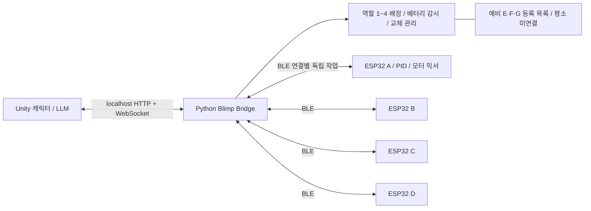

# Blimp Bridge — Python 서버 설계 v0.1

작성: 2026-10-09. **Python 서버 v0.1 구현 완료.** 실행 방법과 구현 범위는 [RUNNING.md](RUNNING.md), 실제 BLE 계약은 [FIRMWARE_CONTRACT.md](FIRMWARE_CONTRACT.md)를 먼저 읽는다. 아래 내용은 원래 설계이며, 구현과 차이가 있으면 이 두 문서를 우선한다. Unity C# 연결 코드·ESP32 펌웨어·실기체 무선 검증은 아직 포함하지 않는다.

확정 요구: Unity 캐릭터가 ESP32 비행선에 명령 전달, 블루투스 연결, 동시 연결 최대 4대, 예비 2~3대의 유동적 교체, 배터리 교체 사전 알림, 교체 중 다른 기체의 연결·제어 유지. 부력은 기체가 제공하며 프로펠러는 방향 전환용 2개와 후방 추력용 1개. PID는 기체 측에서 조정 중. 배터리와 측정 방식은 미정.

설계 가정: 블루투스는 BLE GATT로 구체화한다. Classic SPP로 펌웨어를 이미 정했다면 transport 어댑터를 변경한다. ESP32 정확한 보드·센서·역추진 가능 여부·프로펠러 배치는 아직 확정하지 않는다.

## 1. 연결 구조

- Python: `asyncio` + `Bleak`(Windows BLE Central/GATT Client) + `FastAPI`/`Uvicorn`(Unity용 로컬 API) + SQLite(기체 등록·설정·이벤트 기록).
- ESP32: BLE Peripheral/GATT Server. 센서→PID→모터 출력은 ESP32 내부에서 동작한다. BLE 처리 때문에 PID 루프를 대기시키지 않는다.
- Unity: BLE 기체 주소를 직접 다루지 않고 `slot-1`~`slot-4`로 명령한다. 게임 캐릭터와 slot 관계는 유지되고 실제 drone_id만 교체된다.
- 최대 **BLE 연결 수 4, 활성 제어 기체 수도 4**. 예비 목록은 최소 7대 이상 등록 가능하지만 예비를 상시 연결하지 않는다. 연결하지 않은 예비의 배터리는 마지막 확인 시각을 표시하며 현재 잔량으로 취급하지 않는다.
- Unity/서버를 같은 노트북에서 실행하고 API는 기본 `127.0.0.1`에만 바인딩한다. LLM 추론을 서버 이벤트 루프에 넣지 않는다.
- Uvicorn은 **단일 worker**로 실행한다. 다중 worker는 연결/배정 상태를 분리해 잘못된 명령을 만들 수 있으므로 이 설계에서 지원하지 않는다.

## 2. 기체와 역할의 분리

| 식별자 | 의미 / 수명 |
|---|---|
| drone_id | 기체별 영구 UUID. 펌웨어 NVS 저장·등록. IP, 검색 순서, 표시 이름, 변경 가능한 BLE 주소를 ID로 사용하지 않음 |
| boot_id | ESP32 부팅마다 새 값. 배터리 교체 후 옛 명령을 구분 |
| connection_id | Python 연결 인스턴스별 ID. 이전 연결 종료 콜백이 새 연결 상태를 지우지 않게 함 |
| server_epoch | 서버 실행마다 새 UUID. 서버 재시작 전 명령을 무효화 |
| slot_id | Unity 논리 역할 1~4 |
| binding_epoch | 역할을 배정·해제할 때마다 변경. 늦게 도착한 옛 LLM 응답 차단 |
| control_session | ESP32와 제어 권한을 설정할 때 발급하는 새 난수 토큰. 새 연결/재배정에 재사용하지 않음 |
| command_seq | control_session 내 증가하는 번호. 중복/과거 명령을 거부 |
| battery_session_id | 배터리 교체 확인 시 갱신. 경고·소모량 추정 기록 분리 |

불변 조건: 한 slot에는 최대 한 기체, 한 기체에는 최대 한 slot, 비행/제어 중인 기체와 연결 수는 4 이하. 등록되지 않은 기체는 발견만 하고 자동 연결·arm하지 않는다. 같은 drone_id 중복 출현은 충돌 경고 후 배정 차단한다.

예: `slot-2 → blimp-B`를 `slot-2 → blimp-F`로 교체해도 slot-1/3/4의 연결, 제어 세션, PID 상태는 바꾸지 않는다. B의 PID 이득을 F에 복사하지 않는다. 기체별 보정·capabilities·프로파일을 적용한다.

## 3. 명령 계층

LLM은 목표·행동을 결정한다. Unity의 결정적 명령 생성기가 허용된 동작으로 변환하고 Python이 범위·권한·신선도를 검증한 뒤 ESP32에 전달한다. LLM이 PWM, arm, 배터리 임계값, 세션 토큰을 직접 결정하지 않는다.

초기 제어 계약은 **전진 추력 요청 `surge_norm` + 요 회전율 요청 `yaw_rate_rad_s`**를 후보로 삼는다. 모터 3개의 개별 PWM과 PID 믹싱은 기체에서 담당한다. `surge_norm`은 속도(m/s)가 아니다. 역추진 지원 확인 전에는 음수 추력을 허용하지 않는다. yaw-rate 제어는 IMU/제어기 지원을 보고 활성화한다.

프로펠러 3개라는 정보만으로 상하/좌우 독립 이동이나 위치 유지가 가능하다고 가정하지 않는다. 센서 없는 `go_to(x,y,z)`, `hold_position`, `return_home`은 지원하지 않는다. 이전 LLM 벤치마크의 vx/vy/vz/yaw 출력은 속도 측정용 합성 데이터이며 실제 기체 프로토콜이 아니다.

LLM 판단 간격과 통신 갱신 간격은 분리한다. 예를 들어 유효한 행동을 Unity가 잠정 10Hz로 갱신할 수 있지만, 이는 새 AI 판단 10회/초를 의미하지 않는다. 행동 자체에도 만료시간을 두며, 이전 행동을 무제한 재전송해 만료시간을 연장하지 않는다. 유효한 행동이 없으면 기체별 사전 정의된 만료 동작으로 전환한다.

PID 주파수·만료 동작·최대 추력·회전율은 기체 실험 후 확정한다. 부력이 있어도 모터 정지가 곧 위치 고정이나 안전한 착지를 뜻하지 않는다.

## 4. 배터리 감시와 사전 알림

텔레메트리는 측정 가능한 값만 전송한다: pack_voltage_v, current_a, soc_pct, temperature_c, remaining_seconds, measurement_valid, battery_session_id. 미측정 값은 **null**이며 0%로 대체하지 않는다. 잔여 시간은 측정/추정 출처·신뢰도와 함께 보내며, 전압 하나만으로 '몇 분 남음'을 단정하지 않는다.

상태는 `UNKNOWN → NORMAL → WARNING → REPLACE_REQUIRED → CRITICAL`. 오래된 값은 `STALE`로 표시한다. 연결 상태와 배터리 상태는 독립적으로 유지한다.

- **WARNING:** Unity 해당 역할 카드에 '배터리 교체 준비'와 기체 ID·측정 시각·경고 근거를 표시. 상태 진입 시 알림음 1회. 다른 역할은 유지.
- **REPLACE_REQUIRED:** 해당 역할의 신규 임무 시작을 차단하고 교체 작업을 제안. 아직 회수되지 않은 기체를 즉시 연결 해제하지 않는다. 회수는 운영자가 수행하거나 별도로 검증된 회수 동작으로만 진행.
- **CRITICAL:** 기체의 로컬 배터리 보호가 우선. 서버는 긴급 상태를 알리고 새 일반 명령을 차단한다. 통신이 끊겨도 ESP32의 보호가 작동해야 함.
- **UNKNOWN/STALE:** '잔량 확인 불가' 알림. 이를 정상/완충으로 해석하지 않는다. 기본 정책은 새 arm 차단, 기존 운용은 프로파일에 정의된 열화 동작 적용.

임계값은 배터리 화학계·셀 수·부하·측정 보정에 따라 설정한다. 현 단계에는 전압/퍼센트 임계값을 넣지 않는다. 예시 설정의 null은 '아직 교정되지 않음'이며 실제 arm을 막는 조건이다.

채터링 방지: 이동 필터 + 임계값 지속 시간 + 회복 히스테리시스 + 상태 전이별 이벤트 ID. CRITICAL은 심한 저전압일 때 필터 지연을 우회할 수 있도록 기체 보호와 별도로 정의한다. 경고 확인은 경고 해제나 배터리 회복과 다르다. 전압 반등만으로 교체 완료 처리하지 않는다.

잔여시간 추정이 검증되면 `예상 운용 잔여시간 ≤ 회수 소요시간 + 교체 준비시간 + 여유시간`도 사전 알림 조건으로 사용한다. 잔여시간이 없으면 검증된 전압/SOC 임계값 경고까지만 제공한다. 배터리 사양과 센서 없이 사전 경고 시간을 보장할 수 없다.

## 5. 배터리 교체 절차

1. WARNING/운영자 요청으로 `swap_id`를 생성. 해당 slot에만 작업 잠금, 다른 세 slot은 계속 실행.
2. 해당 slot을 `DRAINING`으로 전환해 새 임무를 막고 일반 명령 큐를 비움. 기체 회수에 필요한 승인된 제한 제어는 기존 세션으로 허용.
3. 실제 회수 완료 후 `disarm` 전송. **ESP32의 disarmed ACK/텔레메트리와 운영자의 회수 확인**을 받고 기존 제어 세션 폐기. 통신 단절 시 전원이 꺼졌다고 추정하지 않고 `RECOVERY_REQUIRED`로 남김; 운영자가 물리적 회수·전원 차단 확인해야 다음 단계 가능.
4. 기존 기체 BLE 연결만 해제해 네 연결 중 한 자리를 확보. slot은 `WAITING_REPLACEMENT`.
5. 등록된 예비 기체 선택→필요 시 짧은 검색→연결. 다른 세 기체는 disconnect/reconnect하지 않음. 예비가 없으면 세 대로 계속 운용하고 빈 역할 표시.
6. 새 기체 ID/boot_id/capabilities/보정 프로파일/배터리 최신값/disarmed 상태 확인. 준비 실패 시 해당 slot만 대기, 재시도 횟수·대기시간 제한.
7. 새 binding_epoch로 배정 확정하고 Unity에 통지. 기본은 `READY_DISARMED`. 운영자가 새 arm을 승인하면 새 control_session을 만들고 **새 행동**부터 시작. 옛 모터 명령·남은 LLM 응답을 재생하지 않음.
8. 교체 완료 이벤트 기록. 기존 기체가 다시 켜져도 예비 목록으로 돌아갈 뿐 옛 slot을 되찾지 않음.

항상 네 대가 동시에 움직이는 '무중단 교체'는 네 연결 제한에서 보장하지 않는다. 교체하는 역할은 잠시 쉬고 **나머지 세 대의 지속 운용**을 목표로 한다. 회수 기체가 안전 확인되지 않았으면 새 기체 arm을 허용하지 않아 물리적 운용 수 제한도 유지한다.

## 6. 장애 격리와 재시작

- 기체별 BLE client, 송신 작업, 수신 상태, timeout, 최신 명령 단일 mailbox를 따로 둔다. FIFO로 오래된 조종 명령을 쌓지 않는다.
- 한 기체의 write timeout/예외는 해당 작업에서 처리. 모든 드론을 한 번에 기다리는 barrier나 한 자식 오류로 전체를 취소하는 TaskGroup을 사용하지 않는다.
- 긴 BLE I/O를 역할 매핑 lock 안에서 await하지 않는다. 짧은 상태 전이만 lock으로 보호한다. reconnect 콜백은 connection_id를 확인해 낡은 콜백을 무시한다.
- 검색·연결 요청은 단일 관리자가 직렬화, 백오프·지터·상한 적용. 기존 연결 작업은 별도로 계속 실행. Bleak에는 스캔으로 얻은 BLEDevice 객체를 넘긴다.
- 수신 telemetry timestamp·sequence 검사. Bluetooth가 connected여도 상태가 오래되면 STALE/DEGRADED. 링크 끊김 시 해당 기체만 LOST.
- GATT write 성공은 '제어 적용 성공'이 아니다. 앱 ACK/텔레메트리의 last_applied_seq로 적용 여부를 확인한다.
- Unity 종료/서버 종료/블루투스 어댑터 장애는 공통 장애다. 서버가 다른 기체를 계속 제어할 수 있다는 보장은 없고, 각 ESP32의 독립 watchdog이 맡는다.
- SQLite에는 등록·프로파일·이벤트·교체 진행 이력을 저장하되 live 연결, arm 권한, 명령 큐는 복원하지 않는다. 서버 재시작 시 모든 역할은 재확인 필요, 새 epoch/session으로 시작.
- 이벤트 기록 실패/버퍼 초과는 상태를 알리고 새 arm/교체 확정을 차단한다. 기존 기체 통신 루프를 동기 디스크 I/O로 막지 않는다.

## 7. 구현 모듈과 API

예정 모듈: `app.py`(FastAPI/lifespan), `registry.py`(기체 등록), `fleet.py`(slot 불변 조건), `sessions.py`(권한/신선도), `transport/ble.py`(Bleak), `battery.py`(필터/상태), `swap.py`(교체 상태기계), `events.py`(Unity 알림), `storage.py`(SQLite), `schemas.py`(검증).

| API | 역할 |
|---|---|
| GET /v1/fleet | 4개 역할·보유 기체·배터리·최신성 snapshot |
| POST /v1/discovery | 제한된 검색 요청. 계속 검색하지 않음 |
| POST /v1/drones/enroll | 운영자가 확인한 기체 등록/프로파일 연결 |
| POST /v1/slots/{slot}/assign | 미할당/disarmed 기체 배정. expected_binding_epoch 필수 |
| POST /v1/slots/{slot}/arm | 준비 조건·운영 권한 확인 후 arm 작업 생성 |
| POST /v1/slots/{slot}/disarm | 해당 역할 disarm 작업 생성 및 ACK 추적 |
| POST /v1/slots/{slot}/actions | 허용 행동과 최대 지속시간 검증 후 action_id·고정 만료시간 발급. binding 변경 시 무효화 |
| POST /v1/slots/{slot}/commands | 바인딩·행동 만료·capability 검증 후 최신값 mailbox 갱신 |
| POST /v1/slots/{slot}/swaps | 교체 시작. Idempotency-Key 필수 |
| POST /v1/swaps/{swap}/confirm-recovered | 회수 확인. 단절 기체에는 별도 물리적 전원 차단 확인 |
| POST /v1/swaps/{swap}/replacement | 새 기체 선택·준비·배정; 자동 arm 없음 |
| GET /v1/operations/{id} | 요청 수락/전달/기체 적용/실패를 구분 |
| WS /v1/events | 배터리 경고·연결 변경·교체 진행·ACK 이벤트 |

UI 이벤트는 event_id로 중복 제거, 연결 복구 시 snapshot 재조회 후 이어받기. 느린 Unity 소비자에게 무제한 backlog를 쌓지 않고 재동기화를 요구한다. arm/교체 등 상태 변경은 idempotency key와 expected binding으로 경쟁 요청을 거부한다. Unity 로컬 연결에도 실행별 인증 토큰을 사용하고 기체는 등록·페어링 정책을 적용한다.

구체적인 메시지 계약과 주기 후보는 [PROTOCOL.md](PROTOCOL.md), 미확정 설정은 [config.example.json](config.example.json)에 둔다.

## 8. 구현 후 합격 시험 (아직 미실행)

먼저 가짜 transport로 제어 상태를 검증한다. 이는 비행체 모델/물리 시뮬레이션이 아니라 통신·상태기계 단위 시험이다.

1. 등록 기체 7대 중 4대 연결, 5번째 연결/중복 slot 배정 거부.
2. B 저전압 경고→회수→F 교체 전 과정에서 A/C/D의 connection_id·control_session 불변, 명령 처리가 계속됨.
3. B 응답 없음/잘못된 payload/송신 지연이 다른 세 작업을 종료하지 않음.
4. 교체 직전 늦은 LLM 응답, 재접속 전 명령, 중복/역순 seq, expired deadline 모두 거부.
5. 배터리 UNKNOWN/STALE, 임계값 근처 출렁임, 센서 오류, 전압 반등, 교체 확인, 반복 경고의 동작 확인.
6. 예비 없음/연결 실패/arm 실패/교체 중 서버 재시작 시 옛 기체 또는 새 기체를 자동 재arm하지 않음.
7. BLE payload 20바이트 한계에서 단편화, 누락/중복/순서 오류, 과대 메시지를 처리하고 완성되지 않은 명령은 미적용.
8. 실기체 프로펠러 구동 전 bench 시험으로 Windows 어댑터의 4연결+교체 검색 중 지연·손실 확인. 스캔이 기존 연결을 방해하면 검색을 줄이고 운용 프로파일을 재설정.
9. Unity/서버 강제 종료 및 RF 단절 시 기체 watchdog·로컬 저전압 보호를 실제 확인.
10. 비교 실측으로 slot별 applied command Hz, RTT p95/max, telemetry age, 경고 전달 지연을 기록. 10Hz 등 후보 수치의 달성 여부와 허용 공백은 이때 정한다.

## 근거 자료

- [Bleak Client](https://bleak.readthedocs.io/en/latest/api/client.html): 동시 연결 수와 연결 중 검색 가능 여부는 어댑터에 따라 달라짐. 소프트웨어 설정만으로 4연결 성능을 보장하지 않음.
- [Bleak 문제 해결](https://bleak.readthedocs.io/en/stable/troubleshooting.html): 다중 연결에서 사전 검색한 BLEDevice 사용.
- [Espressif ESP32-S3 BLE](https://docs.espressif.com/projects/esp-idf/en/stable/esp32s3/api-guides/ble/index.html): BLE 스택 참고. 실제 보드 모델은 별도 확인.
- [FastAPI WebSocket](https://fastapi.tiangolo.com/advanced/websockets/): Unity 이벤트 스트림 구현 근거.
- [ESP32 ADC 보정](https://docs.espressif.com/projects/esp-idf/en/latest/esp32/api-reference/peripherals/adc/adc_calibration.html): 전압 측정 보정 참고. 배터리 분압/보호회로/셀 수는 미정.
